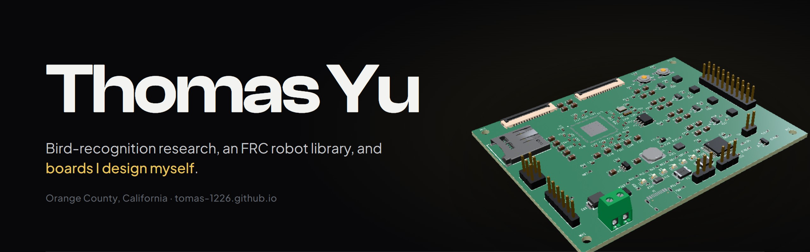
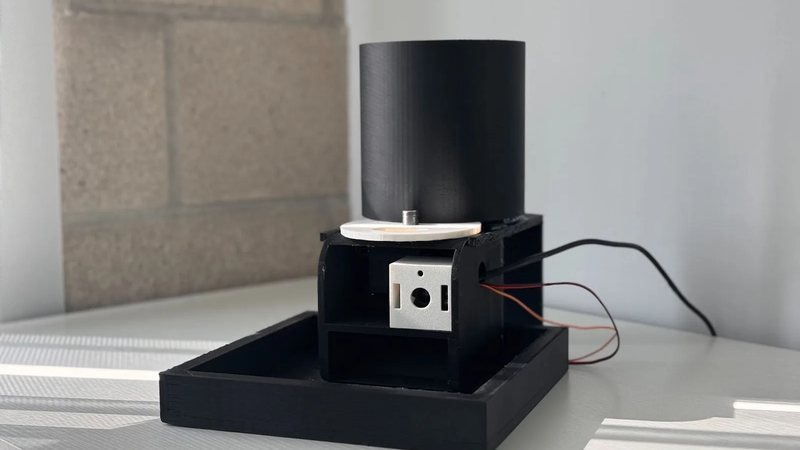
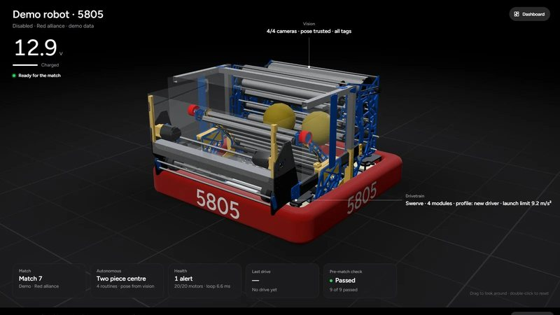
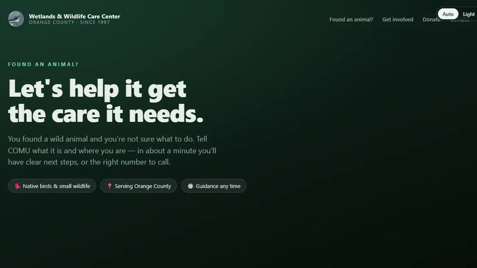
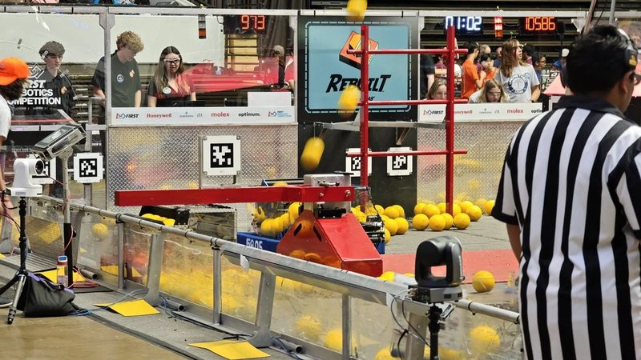
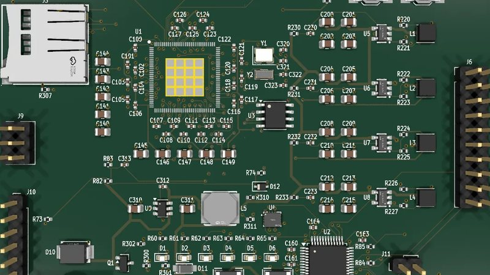
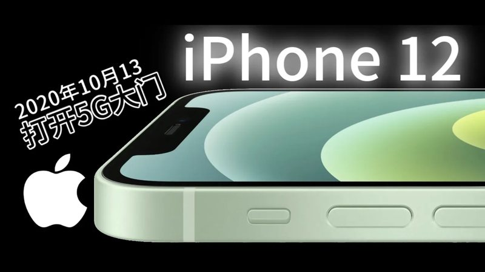

  <a href="https://tomas-1226.github.io"><b>Website</b></a> &nbsp;·&nbsp;
  <a href="mailto:yu_thomas1226@outlook.com">Email</a> &nbsp;·&nbsp;
  <a href="https://huggingface.co/Ornimetrics">Hugging Face</a> &nbsp;·&nbsp;
  <a href="https://space.bilibili.com/1983280115">Bilibili</a> &nbsp;·&nbsp;
  <a href="https://frc5805.com">FRC 5805</a>

I'm a senior at Santa Margarita Catholic High School in Orange County. I like building the whole
thing: the model, the code that runs it, the board it runs on and the box it sits in.

<table>
  <tr>
    <td width="50%" valign="top">
      
      <h3>Ornimetrics</h3>
      A bird feeder that knows who's eating: 555 species on a Raspberry Pi 5 + Hailo-8, a portion for
      each one, injured birds flagged. <b>Peer-reviewed, ADCOM 2026. Patent pending.</b>
        
      <a href="https://huggingface.co/Ornimetrics/ornimetrics-edge">Model</a> ·
      <a href="https://github.com/TomAs-1226/ornimetrics_app">App</a> ·
      <a href="https://csitcp.org/abstract/16/164csit17">Paper</a>
    </td>
    <td width="50%" valign="top">
      
      <h3>Catalyst</h3>
      The whole-robot library for FRC: mechanisms, swerve, a robot-wide state machine, physics and
      autonomy behind builders. <b>1.12 on the roboRIO, 2.0 on Systemcore</b>, plus five apps.
        
      <a href="https://github.com/TomAs-1226/FrcCatalyst">Library</a> ·
      <a href="https://github.com/TomAs-1226/CatalystConsole">Console</a> ·
      <a href="https://tomas-1226.github.io/FrcCatalyst/">Docs</a>
    </td>
  </tr>
  <tr>
    <td width="50%" valign="top">
      
      <h3>COMU</h3>
      An AI front desk for the Wetlands &amp; Wildlife Care Center: four fine-tuned Qwen3.5-9B
      specialists and photo ID. <b>Zero hallucinated phone numbers; the base model made up 8.</b>
    </td>
    <td width="50%" valign="top">
      
      <h3>FRC Team 5805</h3>
      Lead programmer. <b>Ventura County Regional and Beach Blitz winners</b> in 2025, Port Hueneme
      finalists in 2026. I also built <a href="https://frc5805.com">frc5805.com</a>.
    </td>
  </tr>
  <tr>
    <td width="50%" valign="top">
      
      <h3>Hardware</h3>
      <b>O0X</b>, a six-layer camera-and-sensor node for the next feeder, and <b>MOTE</b>, a
      business-card Linux computer. Designed in KiCad; tour them in 3D on the site.
    </td>
    <td width="50%" valign="top">
      
      <h3>TomAs测评</h3>
      My Mandarin tech channel on Bilibili: device reviews and the history of Apple's chips.
      <b>339k views</b>, every video made by me.
    </td>
  </tr>
</table>

### Right now

- **Catalyst 2.0**: bringing the library to FIRST's new Systemcore controller, with Numbers as the first robot on it
- **O0X rev A**: hand-assembling the boards for the next feeder
- **COMU**: putting the assistant on the care center's website
- **MOTE H1**: designing my own RK3576 computer board

### Also made

[**Detent**](https://github.com/TomAs-1226/Detent): fluid motion across SwiftUI, Compose, Flutter and CSS ·
[**Bezel**](https://github.com/TomAs-1226/Bezel): my UI style ·
[**RNA Fold Lab**](https://tomas-1226.github.io/rna-fold-lab/): RNA folding in the browser, built at Carnegie Mellon ·
[**SparkHub**](https://github.com/TomAs-1226/SparkHub): peer tutoring ·
[**Sequence aligner**](https://tomas-1226.github.io/sequence-aligner/)

### Recognition

| | |
|---|---|
| 2026 | Paper presented at ADCOM 2026, Vancouver · U.S. patent application filed |
| 2026 | Coolest Projects Judge's Favourite · First place in AI at Google IgniteCS and at Game Gala |
| 2026 | Carnegie Mellon Pre-College, Computational Biology · RIT Book Award |
| 2025 | Ventura County Regional and Beach Blitz winners (FRC 5805) · High Point University Book Award |

Python · Java · C++ · TypeScript · Dart · PyTorch · YOLO · QLoRA · llama.cpp · WPILib · Phoenix 6 · KiCad · Three.js
